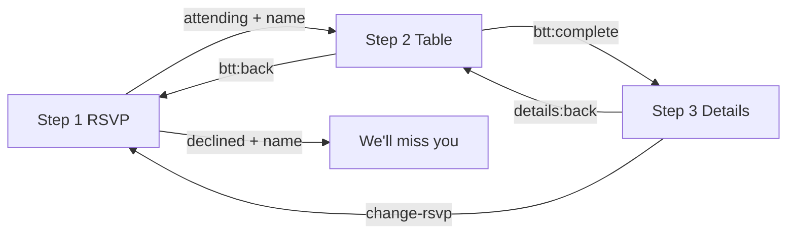

# Balance the Table — built so far

What is **implemented and working** in this repo today (frontend + local mock + Apps Script source), and what still needs **deploy / manual verify / test fixes**.

**Plans:** [BACKEND-PLAN.md](BACKEND-PLAN.md) (API, scenarios, build order) · [GO-LIVE.md](GO-LIVE.md) (deploy checklist)

**Reference event:** `diwali-2026` on `index.html`  
**Backend source:** [`backend/Code.gs`](../backend/Code.gs), [`backend/README.md`](../backend/README.md), [`backend/sheet-template.md`](../backend/sheet-template.md)  
**Local API:** [`scripts/mock-api.mjs`](../scripts/mock-api.mjs) (v2 parity with GAS)

---

## 1. Product flow (3 steps)

| Step | Component | Purpose |
|------|-----------|---------|
| 1 | `<rsvp-attendance>` | Attend or decline → **name** → confirmation or step 2 |
| 2 | `<balance-the-table>` | Pick **savoury** or **sweet**; animated table; copy: **Your move.** + vegetarian note |
| 3 | `<event-details>` | **When / Where / You're bringing**, allergies, **Copy edit link**, change RSVP |

**Orchestration:** `index.html` + `src/boot.js` — boot GET, step routing, fireworks, sync banner.

---

## 2. Architecture

| Layer | Details |
|-------|---------|
| **UI** | Vanilla ES modules, Web Components (Shadow DOM), maroon page `#2a0c0c`, fireworks |
| **Config** | `src/config.js` — default mock API `http://127.0.0.1:8787/exec`; override with `?api=` |
| **Identity** | `src/guest.js` — `guest:{eventId}:id` in localStorage; `?g={uuid}` edit link |
| **Boot** | `src/boot.js` — cache-first GET, route to step 1/2/3 from `me` + `event.state` |
| **API client** | `src/api.js` — `fetchBoot`, `postAction`, retries, name-hint GET |
| **Offline** | `src/sync-queue.js` — queue failed POSTs; flush on `online` and after boot |
| **Build** | `npm run build` → embed bundles in `dist/` (steps 1–2); full app loads `src/` in dev |

---

## 3. Step 1 — RSVP (`src/rsvp-attendance.js`)

### Phases

| Phase | UI |
|-------|-----|
| `intro` | Joyfully yes / Can't make it; optional **Not {name}?** |
| `name` | Name input (40 chars) — **both** attend and decline |
| `attending` | You're on the list! → advances to step 2 |
| `declined` | We'll miss you this time! |
| `blocked` | Copy for `full` / `closed` / `past` (new visitors) |

### Server

- **POST** `action: rsvp` with `status`, `displayName`, `guestId` via `enqueuePost`
- Blocked states from boot; `applyServerState` after failed POST when closed/past

### Events

`rsvp:status`, `rsvp:committed`, `rsvp:not-you`, `rsvp:step-next`, `rsvp:change-rsvp`

---

## 4. Step 2 — Table (`src/balance-the-table.js`)

- **Hydrates** from boot: `dishes`, `people.attending`, `me` (no fake seed when `api` is set; error UI if GET fails)
- **First guest copy:** “You're the first dish on the table.”
- **Vegetarian note:** “It's vegetarian only please.” under **Your move.**
- **POST** contribution / remove via sync queue; `btt:saved` merges `me` into boot state
- **Attending count** drives helper figures (not raw dish count)

---

## 5. Step 3 — Details (`src/event-details.js`)

- **When / Where** from boot `event` (not static HTML attributes)
- **You're bringing** from `me` / completion
- **Allergies** → POST `action: allergies`
- **Copy edit link** `{page}?g={guestId}`
- **Read-only** when `event.state` is not `open` (closed/past): hide change RSVP / copy link / allergies entry

---

## 6. API v2 (mock + GAS)

| | |
|--|--|
| **GET** | `event`, `dishes`, `people`, `me` (and legacy `mine` on GAS) |
| **POST actions** | `rsvp`, `contribution`, `contribution.remove`, `allergies` |
| **Mock seeds** | `?_seed=empty\|host-only\|sweet-heavy\|crowd25` |
| **Mock debug** | `?_state=closed\|full\|past`, `?_latency=`, `?_fail=1` |

Privacy: public GET has no other guests’ names or allergies; only **`me`** for the requesting `guestId`.

---

## 7. What works end-to-end (local)

With **`npm run dev:all`** (site **3456**, mock **8787**):

| Flow | Status |
|------|--------|
| First guest → pick side → step 3 | Works in browser |
| Decline with name | Works |
| Return visit → step 3 if `me.side` set | Works |
| Edit link `?g=` | Works |
| Not you? → new guest id | Works |
| Allergies on step 3 | Works (mock/GAS when deployed) |
| Closed / full / past UI | Works via `?_state=` on mock |
| Offline POST queue + “Saving…” banner | Implemented |

**Google Sheets backend:** code is in repo; **you** deploy `Code.gs` and run [`backend/MANUAL-VERIFY.md`](../backend/MANUAL-VERIFY.md) once per deployment.

---

## 8. Testing

| Command | What it does | Status |
|---------|----------------|--------|
| `npm run test:e2e` | Smoke: steps 1→2→3, card width, allergies | **Flaky in headless** (BTT animation / step timing); use browser manual pass |
| `npm test` | Playwright scenarios A3…C6 vs mock (`scripts/e2e-scenarios.mjs`) | **Not fully green** yet; same headless issue |

Playwright browsers: set `PLAYWRIGHT_BROWSERS_PATH=.playwright-browsers` after `npx playwright install chromium` if installs fail in sandbox.

---

## 9. Commands

| Command | Purpose |
|---------|---------|
| `npm run dev:all` | Mock **8787** + static site **3456** |
| `npm run dev:mock` | Mock only |
| `npm run dev` | Static site only |
| `npm run build` | `dist/` embed bundles |
| `npm run test:e2e` / `npm test` | Playwright |

**Try:** [http://127.0.0.1:3456/index.html?_seed=empty](http://127.0.0.1:3456/index.html?_seed=empty)

---

## 10. File map

| Area | Files |
|------|--------|
| Orchestration | `index.html`, `src/boot.js`, `src/boot-cache.js` |
| Step 1 | `src/rsvp-attendance.js` |
| Step 2 | `src/balance-the-table.js`, `src/plate-scene.js`, `src/api.js` |
| Step 3 | `src/event-details.js` |
| Shared | `src/config.js`, `src/guest.js`, `src/sync-queue.js`, `src/card-shared.css` |
| Mock | `scripts/mock-api.mjs`, `scripts/lib/api-v2-store.mjs`, `scripts/dev-all.mjs` |
| E2E | `scripts/e2e-harness.mjs`, `scripts/e2e-flow.mjs`, `scripts/e2e-scenarios.mjs` |
| Backend | `backend/Code.gs`, `backend/README.md` |

---

## 11. Known gaps / follow-ups

- **E2E:** stabilize headless runs (reduced motion or shorter BTT settle in test mode).
- **Docs:** keep this file in sync after UX copy changes.
- **Production:** deploy GAS, set `?api=` to `/exec` URL (or change `DEFAULT_API_URL` in `src/config.js` for a fixed host).
- **Change RSVP → decline:** server row updates; contribution cleared on decline POST; full “remove figure” for others relies on refresh GET.

---

*Last updated: API v2 client wired to mock; Apps Script v2 in repo; local dev-all is the primary demo path.*
